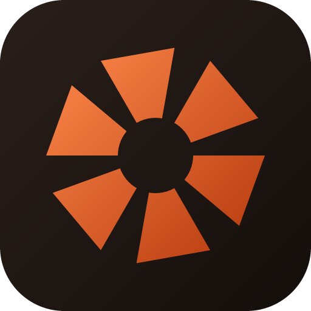

<div align="center">

<h1>RustyEdit</h1>




##### A fast, Lightroom-inspired photo cataloguing and editing app, written entirely in Rust.
Non-destructive RAW development, a GPU-accelerated 16-bit pipeline, and a native desktop app with no Electron, no web view, no telemetry.

</div>

---

## RustyEdit

RustyEdit is a local-first photo cataloguing and editing app: import folders of RAW and ordinary images, cull and organise them, develop them with a full non-destructive editing toolkit, then export or lay them out in a printable zine. Everything — the RAW decoder, the edit pipeline, the UI — is Rust; the window and every widget are drawn directly through [GPUI](https://www.gpui.rs/) (the UI framework behind Zed), with [wgpu](https://wgpu.rs/) running the edit pipeline on the GPU in 16-bit floats end to end, and a CPU path as the reference and fallback.

There's no cloud sync, no account, no subscription. Your catalog, your edits and your originals stay on your disk; sidecar/XMP support means your edits are readable by other tools too.

This is an active, evolving personal project — expect rough edges, and treat it as pre-release software.

## ⭐ Highlights

- **Non-destructive RAW development** — exposure, white balance, tone curves, Color Mixer and Color Grading wheels, detail and lens corrections, all editable at any time, with full undo/redo history per photo;
- **GPU-accelerated pipeline** — every stage (demosaic through output colour conversion) runs on the GPU in 16-bit float when one is available, with a matching CPU path as a tested fallback;
- **Multi-photo editing** — move a slider, drag a curve point, reposition a Color Mixer puck or a Color Grading wheel with several photos selected, and every selected photo moves together, Lightroom's Auto-Sync style;
- **HDR merge** — fuse a bracketed set of same-framing exposures into one well-exposed photo (Mertens-style exposure fusion, blended across a Laplacian pyramid so there's no seam);
- **Smart culling** — automatic sharpness/exposure scoring picks the best of a burst, flags soft or badly-exposed shots, for fast first passes over a big import;
- **Lens Blur** — a synthetic, shape-and-falloff-tunable depth-of-field effect, GPU and CPU paths;
- **Zines** — lay photos out on pages (mat, shadow, rounded corners, tilt) and export a PDF, a booklet-fold sheet, a web page, or an EPUB;
- **Crash-safe** — automatic rolling catalog backups and unclean-exit detection, so a crash doesn't cost you a session's edits;
- **Fully remappable keyboard shortcuts**, a command palette, and an in-app shortcut cheat sheet;

## 🤘 Features

### 📚 Library & Culling

- Grid and filmstrip views, a large single-photo Loupe, side-by-side Compare and multi-photo Survey;
- Stacks (by hand or auto, by capture time), virtual copies, albums/collections, keyword tagging with autocomplete;
- Search and facet filters — colour label, camera, lens, file type, year, ISO, focal length, edited state;
- Smart culling: **Pick best of each burst**, **Reject soft photos**, **Reject bad exposures**, plus flags, 0–5 star ratings and colour labels;
- Exact and visually-similar duplicate detection (sampled content hash + perceptual hash);
- A folder-tree Navigator, multiple named catalogs, and folder sync that picks up new/removed files without losing existing edits;

### 🎛️ Develop

- The full tonal toolkit — Exposure, Contrast, Highlights, Shadows, Whites, Blacks, Texture, Clarity, Dehaze, Vibrance, Saturation;
- **Tone Curve** (master + RGB channels), **Color Mixer** (hue/saturation/luminance per colour band) and four-way **Color Grading** wheels (shadows, midtones, highlights, global);
- **Crop & Straighten** with shape presets, plus automatic upright/level detection;
- **Lens Corrections** — distortion, vignetting and chromatic aberration, matched against the [Lensfun](https://lensfun.github.io) database (if installed) or fitted automatically from the photo itself;
- **Retouch** (Heal/Clone spot removal) and **Content-aware Remove**;
- **Linear and Radial Gradient masks**, each with its own local adjustments;
- **Lens Blur** — adjustable amount, boost, falloff and bokeh shape, with a focus point/plane picked on the photo;
- **Frames** — mats, instant-film borders, film rebates, gilded mouldings;
- Composition guides (thirds, a finer grid, golden ratio, a Fibonacci spiral, golden triangles, diagonals, centre cross);
- Camera matching, Match Look (fit a photo's tones/cast/grade to a reference image), and "new preset from a photo";
- Fujifilm film-simulation recipe import, turned straight into Develop settings;
- Soft-proofing against another colour space, with out-of-gamut warnings;
- A sharp full-resolution detail view when zoomed in past what the working preview can show;

### 🕘 History, Snapshots & Undo

- A full change log per photo, oldest to newest, each step hoverable for an instant before/after preview;
- Named snapshots to keep alternative edits and return to them;
- Undo/redo across flags, ratings, labels and every Develop change, including multi-photo edits as one step;
- Copy/paste edits, "sync settings" (chosen sections only) across a selection, and a one-click reset;

### 📤 Export & 📰 Zines

- JPEG, PNG, TIFF and BMP, 8- or 16-bit, with resizing, output sharpening, colour-space conversion and a configurable text watermark;
- Export presets (Web, Instagram, Client proofs, …) and live preview tiles showing exactly what will be written;
- **Zines**: lay out photos on pages — framed with shadow, mat, rounded corners and tilt — and export a print-ready PDF (flat pages or a booklet-fold sheet), a standalone web page, or an EPUB;

### 🗄️ Catalog, Backups & Recovery

- Automatic rolling catalog backups and unclean-exit (crash) detection, offering the latest backup back on the next launch;
- Manual backup/restore, catalog optimisation, and thumbnail/preview cache management;
- XMP sidecar read/write, so edits are visible to (and readable from) other tools;

### ⌨️ Built your way

- A searchable command palette for every action in the app;
- Every keyboard shortcut is remappable from a live recorder in Settings, with an in-app cheat sheet (`?`);

## 🏗️ Architecture

RustyEdit is a Rust workspace of five crates:

- **`rustyedit-core`** — the domain model: assets, catalogs, Develop settings, curves, history, presets. No UI or filesystem dependency, so it's cheap to test in isolation.
- **`rustyedit-processing`** — the non-destructive edit pipeline: RAW development, lens/geometry corrections, tone/colour/detail, finishing (curves, mixer, grading, gradients), crop, HDR merge, lens blur, and colour-space conversion. Every stage runs on the GPU (via [wgpu](https://wgpu.rs/)) in 16-bit floats when one's available, with CPU implementations as the reference and fallback.
- **`rustyedit-io`** — filesystem concerns: folder scanning, thumbnail generation and caching, catalog persistence, XMP sidecars, zine rendering (PDF/web/EPUB), kept free of any UI dependency so it can run on background threads.
- **`rustyedit-ui`** — shared GPUI widgets: sliders, panels, icons, the design system the rest of the app is built from.
- **`rustyedit`** (`crates/app`) — the window, menus, keybindings, and every screen (Library, Develop, Export, Zines), built on [GPUI](https://www.gpui.rs/).

RAW decoding is handled by [`rawler`](https://crates.io/crates/rawler); colour management by [`moxcms`](https://crates.io/crates/moxcms); vector rendering (watermarks, the app icon) by [`resvg`](https://crates.io/crates/resvg).

GPUI targets macOS, Windows and Linux; RustyEdit is developed and tested mainly on macOS so far.

## 🛠️ Building from source

```bash
git clone https://github.com/mascanho/rustyEdit.git
cd rustyEdit
cargo run -p rustyedit
```

On macOS, `./scripts/bundle-mac.sh` builds a release binary into a proper `RustyEdit.app` (with the icon, so Finder, Spotlight and the Dock show it correctly) at `target/release/bundle/RustyEdit.app`.

## ⌨️ A few keymaps

The full list is live in-app: press **?** (or Shift+/) for the shortcut sheet, or **⌘K** for the command palette. Every shortcut can be remapped in Settings.

|      Keys       | Result                      |
| :--------------: | --------------------------- |
|        G         | Library                     |
|        D         | Develop                     |
|        L         | Loupe / grid                |
|        E         | Export                      |
| ⌘O | Import a folder              |
|        P         | Pick                         |
|        X         | Reject                       |
|      0 – 5       | Star rating                  |
|      6 – 9       | Colour label                 |
| ⌘Z / ⌘⇧Z | Undo / redo           |
| ⌘'          | Create virtual copy          |
| ⌘⇧S | Sync settings                |
|  ⌘K  | Command palette              |

